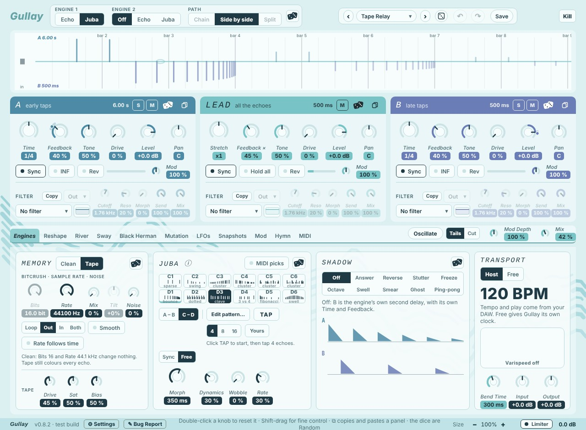
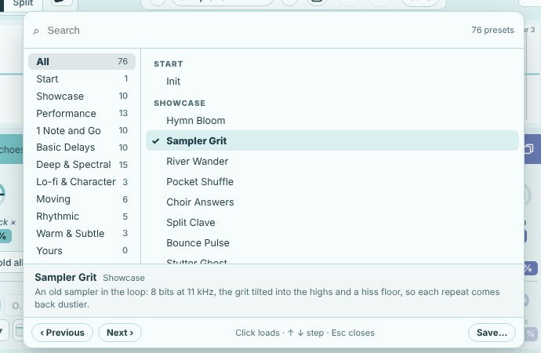
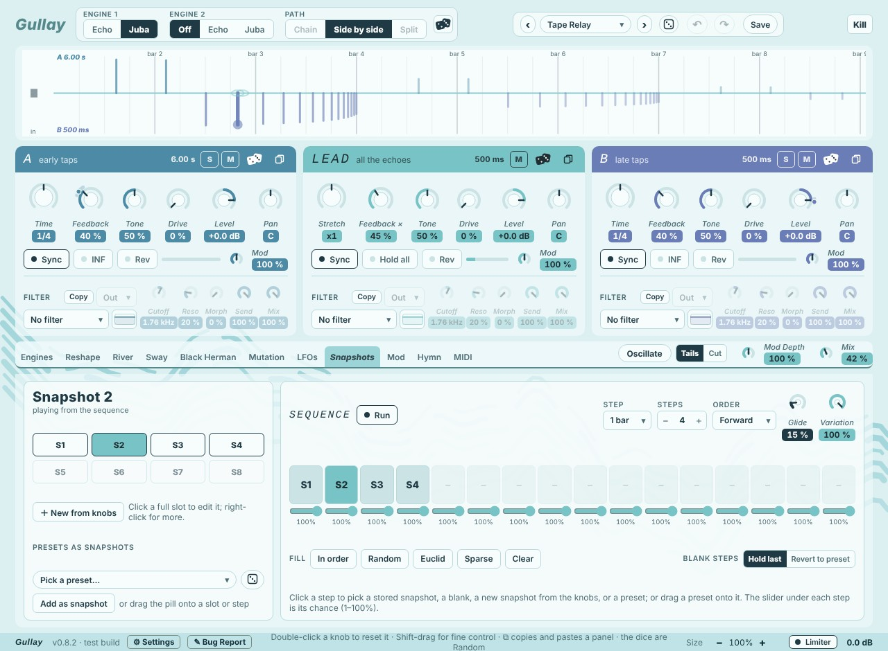
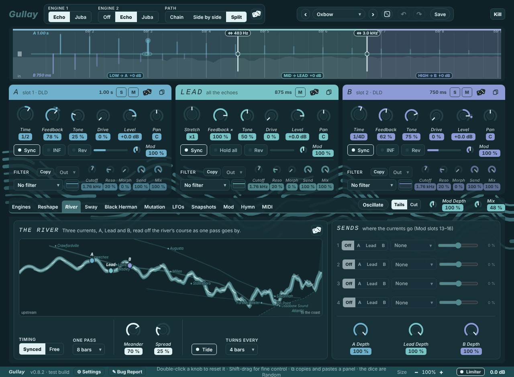
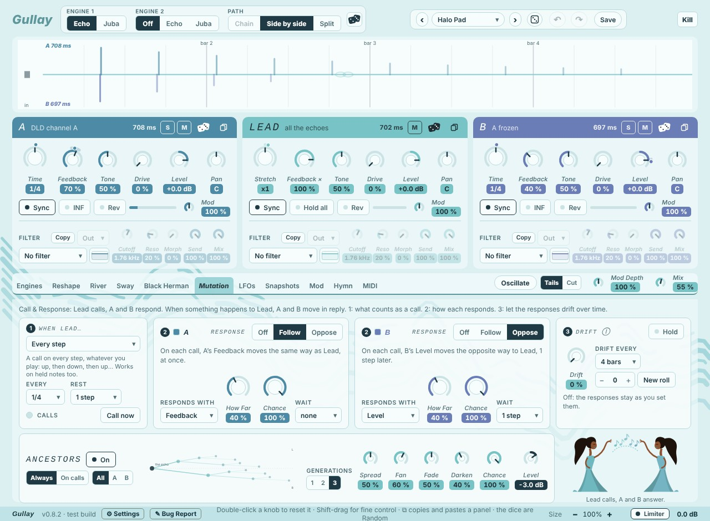
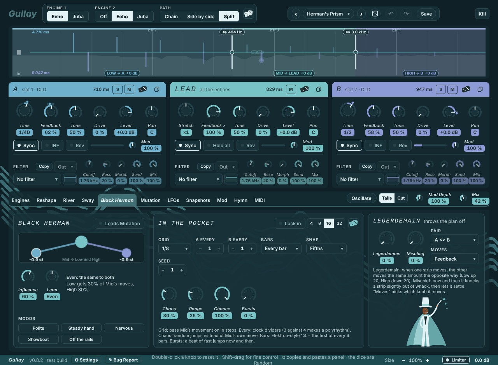
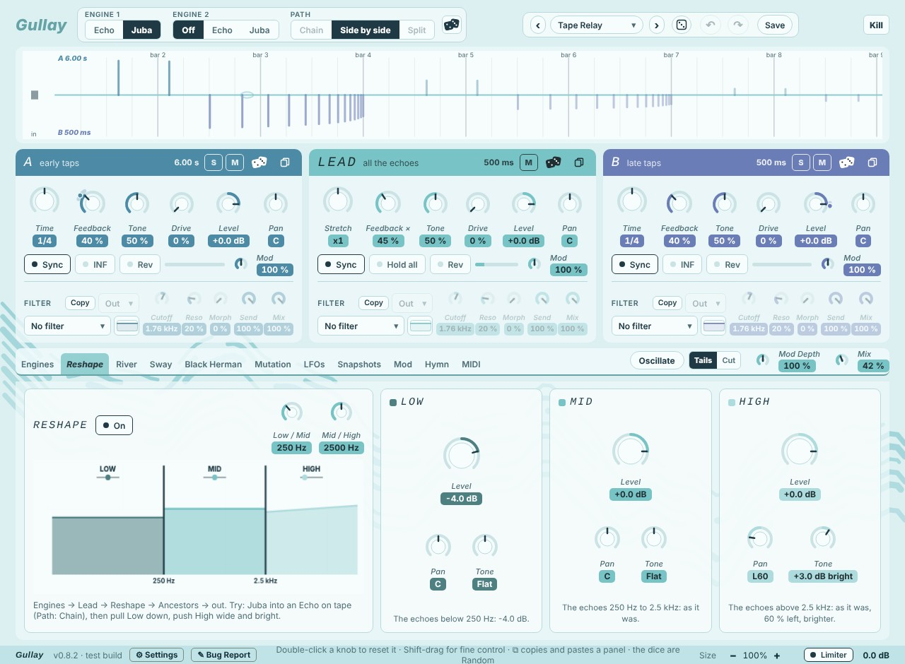
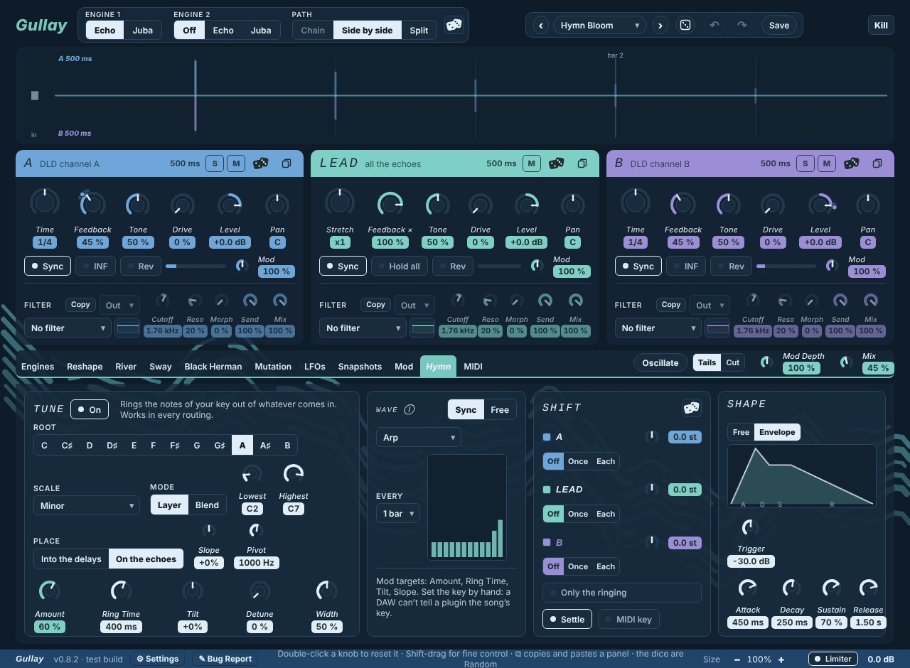

# Gullay

**A delay that keeps moving.** Three parts (A, Lead and B), two engines and a set of pages that change the echoes over time. Available as CLAP, VST3 and AU for Mac, and CLAP and VST3 for Windows.

## Download

| | |
|---|---|
| **Mac** (macOS 11+, Apple Silicon and Intel) | [**Download for Mac**](https://github.com/dans314/gullay/releases/latest/download/Gullay-v0.8.2-mac.zip): CLAP, VST3 and AU |
| **Windows** (10 / 11, 64-bit) | [**Download for Windows**](https://github.com/dans314/gullay/releases/latest/download/Gullay-v0.8.2-windows.zip): CLAP and VST3 |

**New here?** The [**Quick start**](docs/QUICKSTART.md) gets you playing in five minutes: install, first presets and the controls. The [**full manual (PDF)**](docs/Gullay-Manual.pdf) has screenshots of every page. Every version is on the [Releases](https://github.com/dans314/gullay/releases) page.

> v0.8.2 is a **test build**. Please send feedback: click **Bug Report** in the window's footer and send the file it writes, along with what you heard.

## What it does

- **Two engines.** *Echo*, from the 4ms Dual Looping Delay, and *Juba*, from the 4ms Tapographic Delay, which plays rhythmic multi-tap patterns. You can also draw your own pattern. Run one engine, or two together in a chain, side by side, or split by frequency.
- **A, Lead and B.** A and B are the two delays. Lead stretches both and colours every echo. Each part has its own filter, drive, tone and pan.
- **Memory.** Clean or tape echoes, with bit and sample-rate grit.
- **Shadow.** B answers A: reversed, stuttered, frozen, an octave up or down, swelled, smeared or ping-ponged.
- **Pages that move the sound.** River, Sway, Black Herman, Mutation, three LFOs and a 16-route Mod page.
- **Snapshots.** Eight whole-sound snapshots and a step sequencer with per-step chance, following your DAW.
- **Hymn.** Rings the notes of your key out of whatever comes in.
- **76 presets**, each with a one-line description. They include *Performance* presets that bring their own snapshot sequences, and *1 Note and Go*: play one note and get four bars of arps or soundscape.
- **Kill** empties every echo at once, and a **Limiter** guards the output.

<table>
<tr>
<td width="50%"> <b>Presets.</b> Search, categories, and a description for every preset. One click loads a preset and the menu stays open.</td>
<td width="50%"> <b>Snapshots.</b> Eight whole-sound snapshots and a step sequencer with chance per step.</td>
</tr>
<tr>
<td> <b>River.</b> Three slow currents read off a river's course. Shown here with a split by frequency.</td>
<td> <b>Mutation.</b> Lead calls, and A and B answer. Ancestors grows a family tree of echoes.</td>
</tr>
<tr>
<td> <b>Black Herman.</b> A magician nudges A and B in steps, with moods, In the Pocket and Legerdemain.</td>
<td> <b>Reshape.</b> Three bands after the engines, each with its own level, pan and tone.</td>
</tr>
<tr>
<td> <b>Hymn.</b> Rings your key's notes out of the echoes, with arps and an envelope.</td>
<td>Nine colour themes, light and dark, and a window from 75 % to 150 %. Right-click any knob to modulate it or to MIDI Learn it.</td>
</tr>
</table>

## Install in short

- **Mac:** unzip, then paste the one Terminal command from the [Quick start](docs/QUICKSTART.md#mac-macos-11-or-later-apple-silicon-or-intel). It copies the plugins into place and clears macOS's block on downloaded plugins. Rescan in your DAW.
- **Windows:** unzip, copy `Gullay.clap` to `C:\Program Files\Common Files\CLAP\` and `Gullay.vst3` to `C:\Program Files\Common Files\VST3\`, then rescan.

## Building from source

- **Mac:** `sh build-all-mac.sh` (needs `brew install cmake`). It builds CLAP, VST3 and AU and installs them.
- **Windows:** built by GitHub Actions on every push (`.github/workflows/build.yml`), which also runs the host test on Windows.
- **Tests:** `sh run-tests.sh`. Where things stand: [docs/STATUS.md](docs/STATUS.md).

## Licence and credits

Gullay is free software under the GNU GPL v3 ([LICENSE](LICENSE)). It builds on Three's Company, 4ms Company's Dual Looping Delay and Tapographic Delay, the CHOW Tape Model, Valley Audio's Plateau and Cloud Seed. Full credits are in [NOTICES.md](NOTICES.md).
